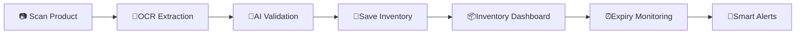
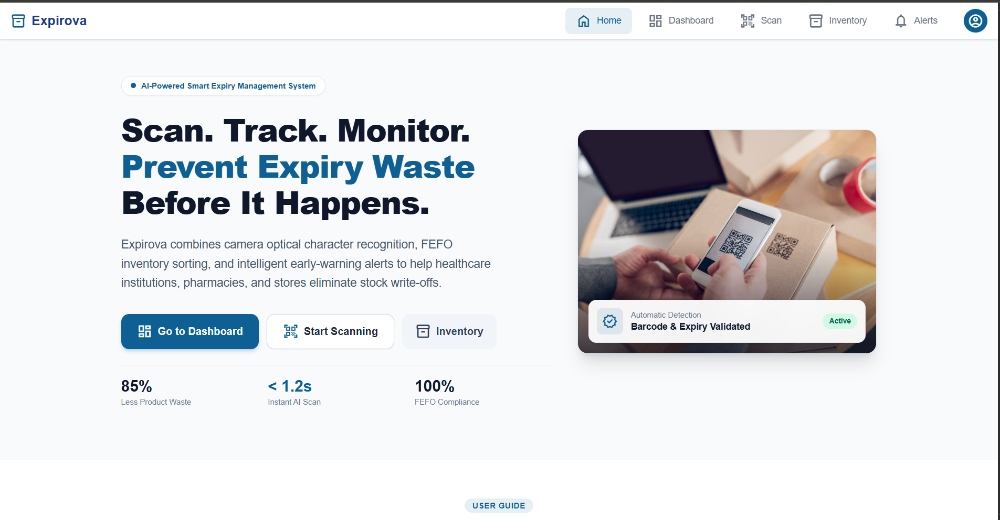
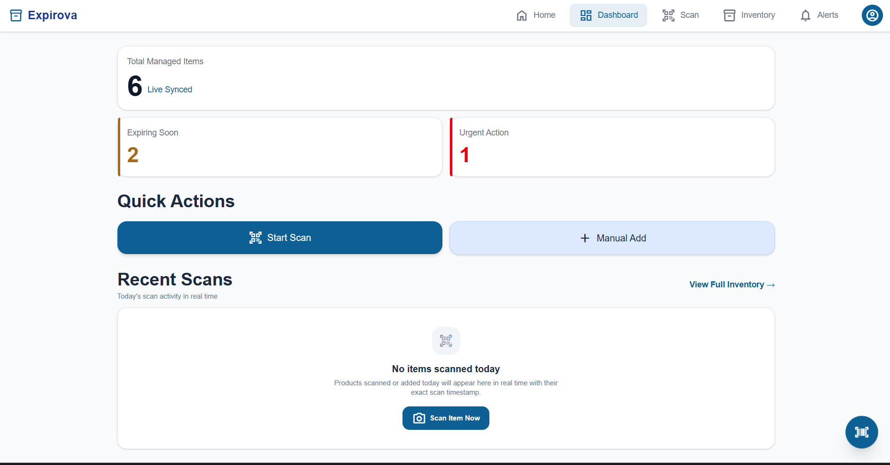
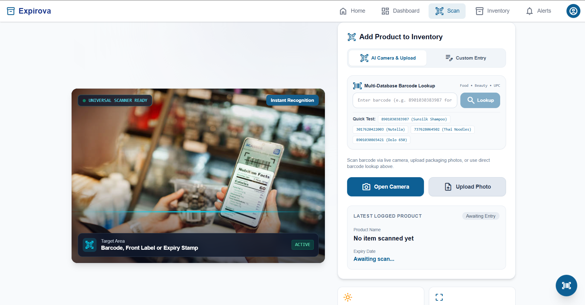
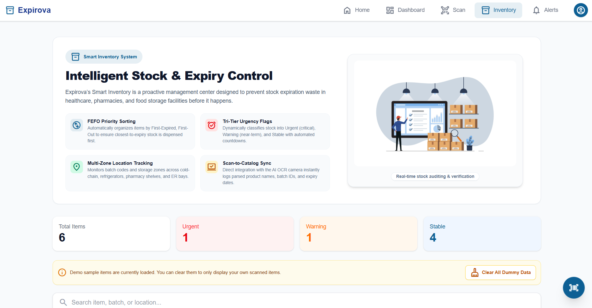
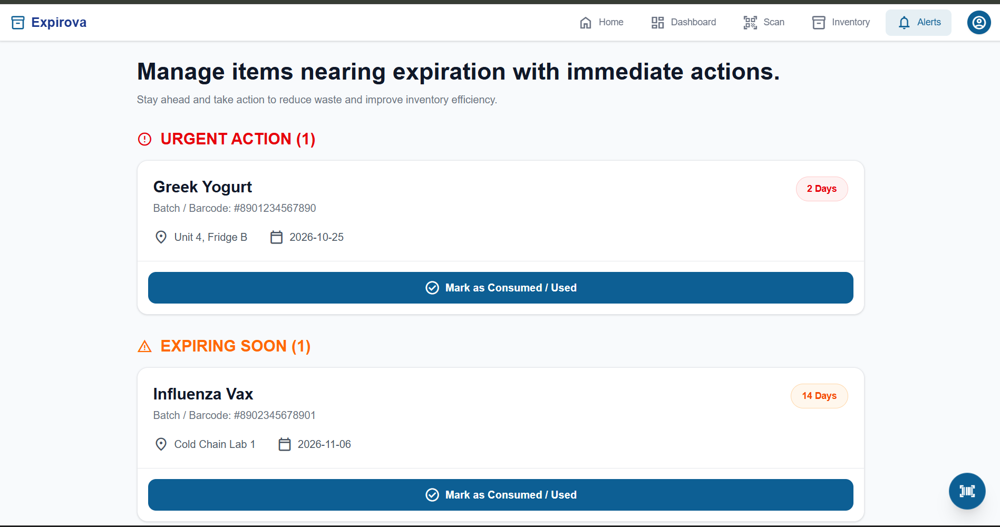
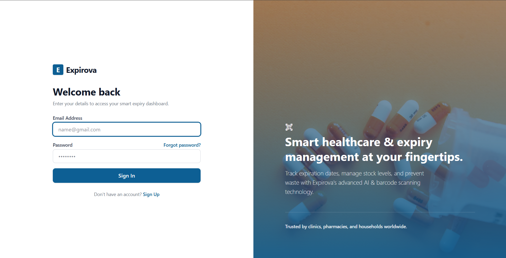
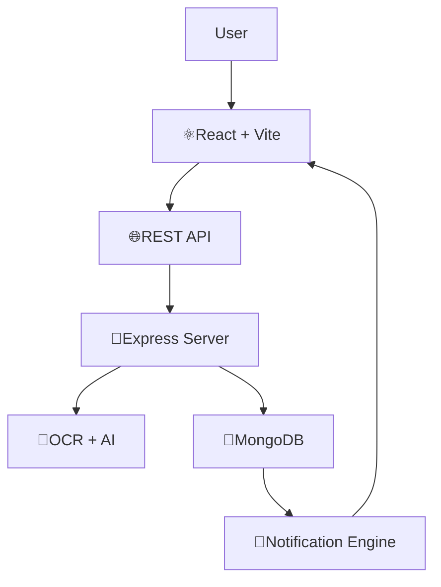

  

**AI-Powered Smart Expiry Management System**

*Scan • Track • Monitor • Prevent Waste*

---

## 💻Why Expirova?

* 💊 **Rapid Multimodal Scanning** — Identifies items and extracts expiry dates in seconds.
* 🤖 **Automated Vision AI** — Neural OCR accurately captures packaging text without manual entry.
* 📦 **FEFO Inventory Control** — Automatically prioritizes stock using First-Expired, First-Out sorting.
* 🚨 **Proactive Expiry Alerts** — Real-time monitoring with customizable early-warning cadences.
* 📈 **Live Operations Dashboard** — Actionable telemetry on managed stock, urgent items, and consumption.
* 📱 **Fully Responsive** — Seamlessly accessible on mobile devices, tablets, and desktop workstations.
* ⚡ **Enterprise & Household Ready** — Engineered for clinics, pharmacies, pantries, and homes.

---

## ✨Features at a Glance

<table>
<tr>
<td align="center" width="25%">

### 📸Smart OCR Scan
Extracts medicine details directly from labels using AI-powered OCR.

</td>

<td align="center" width="25%">

### 📦Inventory Management
Organize, search, filter, and manage products using FEFO.

</td>

<td align="center" width="25%">

### 🚨Smart Alerts
Receive proactive notifications before products expire.

</td>

<td align="center" width="25%">

### 📊Analytics Dashboard
Monitor inventory health with real-time statistics.

</td>
</tr>
</table>

---

## ⚡User Flow

---

##  🖼️Application Screenshots

<table>
<tr>
<td align="center" width="50%">

### 🌐Web Platform Home

Smart expiry management hero interface with FEFO metrics overview.

</td>
<td align="center" width="50%">

### 📊Dashboard

Real-time inventory statistics, urgent actions, and daily activity logs.

</td>
</tr>
<tr>
<td align="center" width="50%">

### 📷Smart Scanner

Multi-database barcode reader and Vision OCR label detection pipeline.

</td>
<td align="center" width="50%">

### 📦Smart Inventory

FEFO-prioritized stock tracking with dynamic multi-zone shelf locations.

</td>
</tr>
<tr>
<td align="center" width="50%">

### 🚨Real-Time Alerts

Expiration countdowns with one-tap consumption confirmation action.

</td>
<td align="center" width="50%">

### 👤Profile & Settings

Configurable reminder thresholds, auth sync, and notification controls.

</td>
</tr>
</table>

---

##  🚀System Architecture

---

## 💻 Tech Stack

| Layer | Primary Technologies | Capabilities & Tooling |
| :--- | :--- | :--- |
| **Frontend** | React 18, Vite | Tailwind CSS, Lucide Icons, React Router |
| **Backend** | Node.js, Express.js | REST APIs, JWT, Multer, Axios |
| **Database & Auth** | Supabase (PostgreSQL) | Row Level Security (RLS), Supabase Auth, Realtime Engine |
| **AI & Vision** | Google Gemini Vision API | Multimodal OCR, Packaging Label Parsing, EXP Extraction |
| **External Registries** | Open Food Facts API | Open Beauty Facts API, Barcode Lookup Services |
| **Deployment** | Vercel (Frontend) | Render (Backend), Git / GitHub CI |

---

## 🏆 Built For

* 🏥 **Hospitals & Clinics** — Surgical packs, vaccines, and diagnostic kits
* 💊 **Pharmacies** — Batch control, regulated drugs, and shelf audits
* 🧪 **Laboratories** — Chemical reagents, test solutions, and cold chains
* 🏬 **Warehouses & Logistics** — Large-scale stock turnover and inventory health
* 🥫 **Pantry & Food Services** — Fresh produce, dairy, and packaged perishables
* 🏪 **Retail Stores** — Front-shelf expiry tracking and reduced write-offs
  
---

  

 
